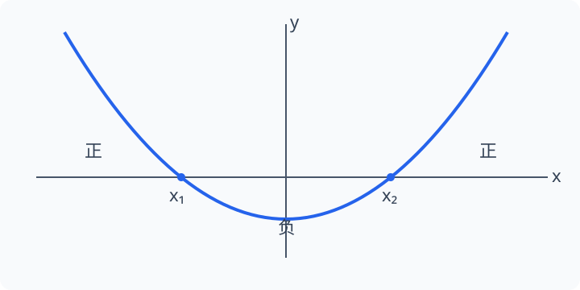

# 二次函数与不等式专题

## 学习目标

能联结一元二次方程的根、抛物线图像和不等式解集；能讨论参数和端点；能使用基本不等式并验证等号。

## 1. 图像、根与符号

对 $f(x)=ax^2+bx+c$（$a\ne0$），对称轴为 $x=-b/(2a)$，判别式 $\Delta=b^2-4ac$。当 $a>0$ 且 $\Delta>0$，设两根为 $x_1<x_2$，图像在两根之间位于横轴下方，两根之外位于上方。

若 $a<0$，所有非零区间的符号相反。$\Delta=0$ 时图像在重根处接触横轴；$\Delta<0$ 时没有实根，函数值始终与 $a$ 同号。严格不等式不包含零点；非严格不等式可以包含零点，但仍需满足原题定义域。

**例**：解 $2x^2-5x-3\le0$。分解为 $(2x+1)(x-3)\le0$，开口向上，故解为 $[-1/2,3]$。

## 2. 含参问题：先判断能否降次

当二次项系数含参数时，先讨论它是否为零；若为零，题目转为一次或常数不等式。若系数非零，再按判别式与根的位置讨论。求“对所有实数 $x$ 恒有 $ax^2+bx+c>0$”时，真正的二次情形条件是 $a>0$ 且 $\Delta<0$；还应单独考虑 $a=0$ 的退化情形。

**例**：求使 $x^2-2mx+4>0$ 对所有实数 $x$ 成立的 $m$。配方得 $(x-m)^2+4-m^2$，全体实数上的最小值为 $4-m^2$，故 $-2<m<2$。等号处最小值为零，不满足严格大于。

## 3. 分式不等式与定义域

求解 $(x-1)/(x+2)\ge0$ 时，关键点为分子零点 $1$ 和分母零点 $-2$。按 $(-\infty,-2)$、$(-2,1)$、$(1,+\infty)$ 判断符号：前后为正，中间为负；$1$ 可以取，$-2$ 不能取，所以解集是 $(-\infty,-2)\cup[1,+\infty)$。

不要直接两边乘以 $x+2$ 而不讨论正负；也不要把分母零点写入解集。

## 4. 基本不等式与取等

当 $u,v\ge0$ 时，$u+v\ge2\sqrt{uv}$，等号当且仅当 $u=v$。求最值时还要验证相关量的定义、定值关系和取等点在允许范围内。

**例**：$x>0$ 时，$x+9/x\ge2\sqrt9=6$；当 $x=3$ 时取等，故最小值为 $6$。若附加 $x>3$，则 $x=3$ 不允许，$6$ 只是下界而非最小值。

## 分层练习

1. 解 $x^2-x-6>0$。
2. 解 $(x+3)/(x-1)<0$。
3. 求 $x>0$ 时 $x+4/x$ 的最小值，并给出取值点。
4. 求使 $x^2-2x+m\ge0$ 对所有实数 $x$ 成立的 $m$。

## 答案与复盘

1. 因式分解为 $(x-3)(x+2)$，解为 $(-\infty,-2)\cup(3,+\infty)$。
2. 关键点为 $-3,1$，两者之间符号为负，解为 $(-3,1)$。
3. 最小值为 $4$，在 $x=2$ 取到。
4. 配方为 $(x-1)^2+m-1$，故 $m\ge1$。

**复盘**：先确定定义域；分清严格与非严格；参数可能使二次项消失；不等式取等点必须满足全部条件。
